# SmartMoney-4 decision review cases

Model observations, NOT expert ground truth. Candles stop at the decision; future outcomes are hidden.
For each case: confirm/correct the broken level, sweep validity, range anchors and earliest knowable setup time.
Gold is provisional: original server timezone/feed and 4h session ownership are unverified.

## BTC_REFERENCE-V62-1: SWEEP_CONTEXT_RECOVERED

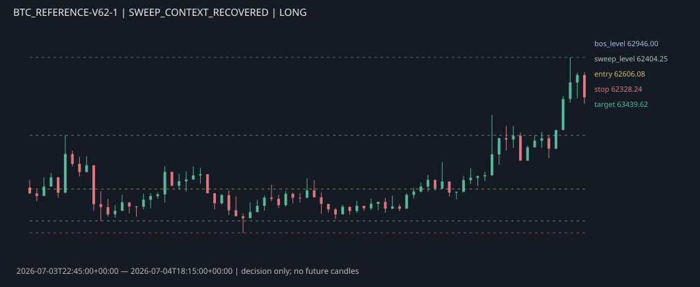

- Direction: LONG; score: 75; missing: HTF.
- Candidate confirmed: 2026-07-04T18:30:00+00:00.
- Candidate setup ready: 2026-07-04T18:30:00+00:00; comparison terminal: see event ledger.
- Owner source/known: 2026-07-04T00:00:00+00:00 / None.
- Sweep/BOS: 2026-07-04T06:15:00+00:00 / 2026-07-04T17:15:00+00:00.
- Frozen range: 2026-07-04T06:15:00+00:00 → 2026-07-04T17:45:00+00:00.
- Checks: {"bos": true, "htf": false, "imbalance": true, "poc_pass": false, "sweep": true}.
- Expert verdict: PENDING. Explain the first incorrect or missing primitive, not whether the later trade wins.

## BTC_REFERENCE-V62-2: V61_POSITIVE_PRESERVED

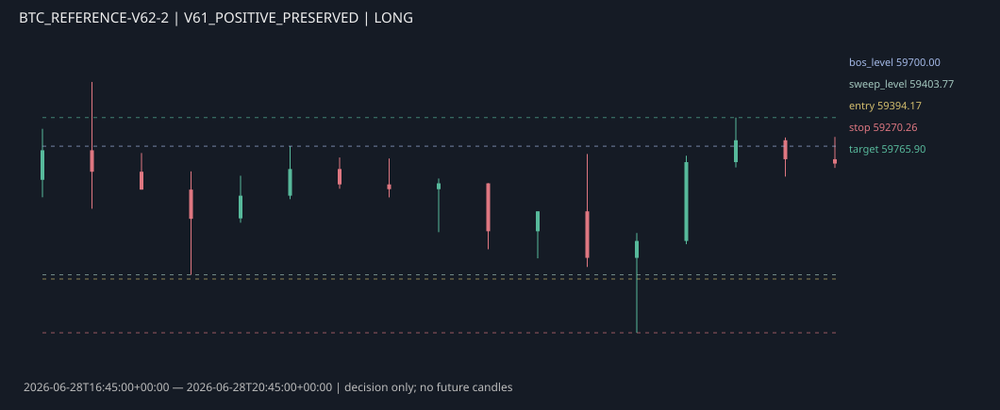

- Direction: LONG; score: 75; missing: FVG.
- Candidate confirmed: 2026-06-28T21:00:00+00:00.
- Candidate setup ready: 2026-06-28T21:00:00+00:00; comparison terminal: see event ledger.
- Owner source/known: 2026-06-28T18:00:00+00:00 / None.
- Sweep/BOS: 2026-06-28T19:45:00+00:00 / 2026-06-28T20:15:00+00:00.
- Frozen range: 2026-06-28T19:45:00+00:00 → 2026-06-28T20:15:00+00:00.
- Checks: {"bos": true, "htf": true, "imbalance": false, "poc_pass": false, "sweep": true}.
- Expert verdict: PENDING. Explain the first incorrect or missing primitive, not whether the later trade wins.

## BTC_REFERENCE-V62-3: V61_POSITIVE_PRESERVED

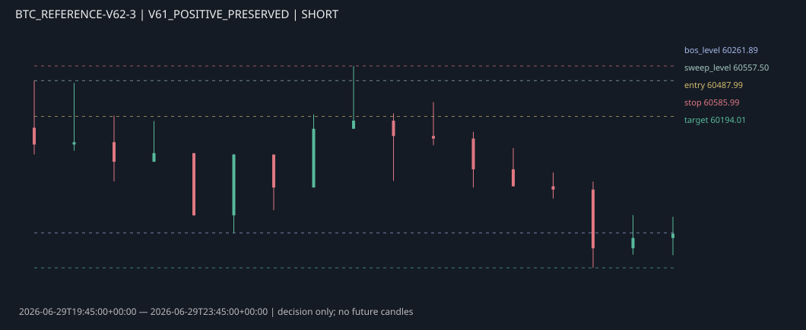

- Direction: SHORT; score: 75; missing: FVG.
- Candidate confirmed: 2026-06-30T00:00:00+00:00.
- Candidate setup ready: 2026-06-30T00:00:00+00:00; comparison terminal: see event ledger.
- Owner source/known: 2026-06-29T21:00:00+00:00 / None.
- Sweep/BOS: 2026-06-29T21:45:00+00:00 / 2026-06-29T23:15:00+00:00.
- Frozen range: 2026-06-29T21:45:00+00:00 → 2026-06-29T23:15:00+00:00.
- Checks: {"bos": true, "htf": true, "imbalance": false, "poc_pass": false, "sweep": true}.
- Expert verdict: PENDING. Explain the first incorrect or missing primitive, not whether the later trade wins.

## BTC_REFERENCE-V62-4: NO_LINKED_SWEEP_NEGATIVE

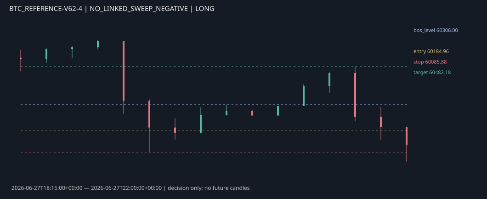

- Direction: LONG; score: 25; missing: HTF, LQ, FVG.
- Candidate confirmed: 2026-06-27T22:15:00+00:00.
- Candidate setup ready: NO ready setup asserted for this case; comparison terminal: see event ledger.
- Owner source/known: 2026-06-27T20:15:00+00:00 / None.
- Sweep/BOS: None / 2026-06-27T21:00:00+00:00.
- Frozen range: 2026-06-27T19:30:00+00:00 → 2026-06-27T21:30:00+00:00.
- Checks: {"bos": true, "htf": false, "imbalance": false, "poc_pass": false, "sweep": false}.
- Expert verdict: PENDING. Explain the first incorrect or missing primitive, not whether the later trade wins.

## BTCUSDT-V62-1: SWEEP_CONTEXT_RECOVERED

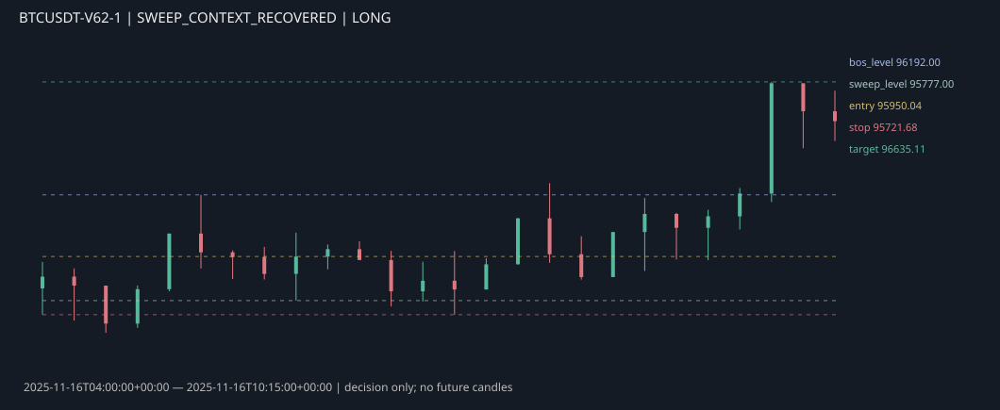

- Direction: LONG; score: 75; missing: FVG.
- Candidate confirmed: 2025-11-16T10:30:00+00:00.
- Candidate setup ready: 2025-11-16T10:30:00+00:00; comparison terminal: see event ledger.
- Owner source/known: 2025-11-16T05:15:00+00:00 / None.
- Sweep/BOS: 2025-11-16T07:15:00+00:00 / 2025-11-16T09:30:00+00:00.
- Frozen range: 2025-11-16T07:15:00+00:00 → 2025-11-16T09:45:00+00:00.
- Checks: {"bos": true, "htf": true, "imbalance": false, "poc_pass": false, "sweep": true}.
- Expert verdict: PENDING. Explain the first incorrect or missing primitive, not whether the later trade wins.

## BTCUSDT-V62-2: V61_POSITIVE_PRESERVED

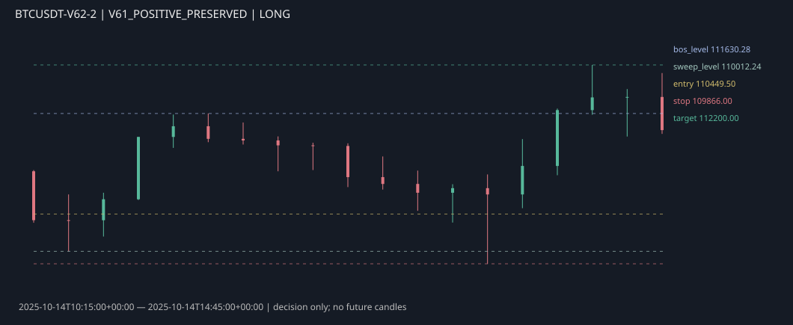

- Direction: LONG; score: 75; missing: FVG.
- Candidate confirmed: 2025-10-14T15:00:00+00:00.
- Candidate setup ready: 2025-10-14T15:00:00+00:00; comparison terminal: see event ledger.
- Owner source/known: 2025-10-14T11:30:00+00:00 / None.
- Sweep/BOS: 2025-10-14T13:30:00+00:00 / 2025-10-14T14:00:00+00:00.
- Frozen range: 2025-10-14T13:30:00+00:00 → 2025-10-14T14:15:00+00:00.
- Checks: {"bos": true, "htf": true, "imbalance": false, "poc_pass": false, "sweep": true}.
- Expert verdict: PENDING. Explain the first incorrect or missing primitive, not whether the later trade wins.

## BTCUSDT-V62-3: SWEEP_CONTEXT_RECOVERED

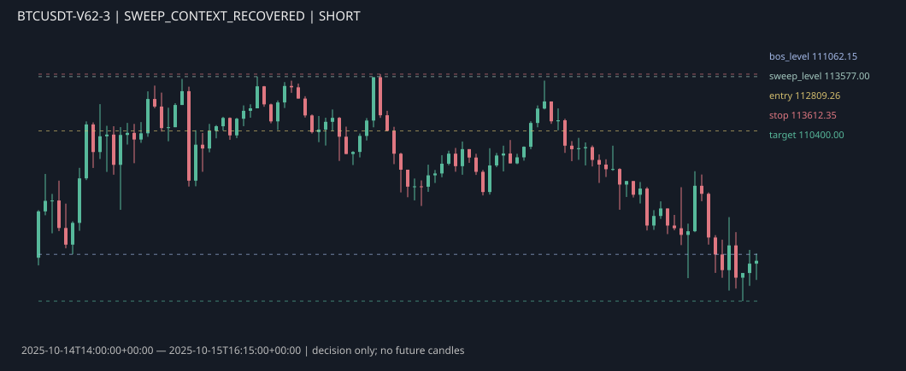

- Direction: SHORT; score: 75; missing: HTF.
- Candidate confirmed: 2025-10-15T16:30:00+00:00.
- Candidate setup ready: 2025-10-15T16:30:00+00:00; comparison terminal: see event ledger.
- Owner source/known: 2025-10-14T15:15:00+00:00 / None.
- Sweep/BOS: 2025-10-15T02:30:00+00:00 / 2025-10-15T14:45:00+00:00.
- Frozen range: 2025-10-15T02:30:00+00:00 → 2025-10-15T15:45:00+00:00.
- Checks: {"bos": true, "htf": false, "imbalance": true, "poc_pass": false, "sweep": true}.
- Expert verdict: PENDING. Explain the first incorrect or missing primitive, not whether the later trade wins.

## BTCUSDT-V62-4: V61_POSITIVE_PRESERVED

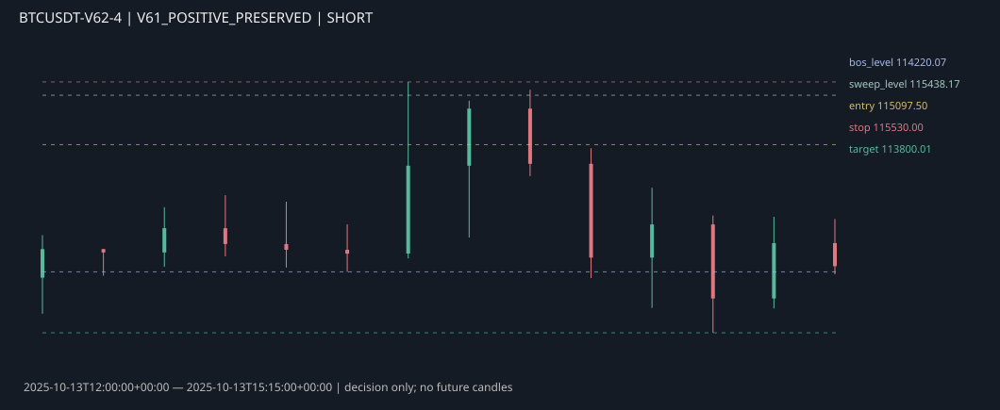

- Direction: SHORT; score: 75; missing: FVG.
- Candidate confirmed: 2025-10-13T15:30:00+00:00.
- Candidate setup ready: 2025-10-13T15:30:00+00:00; comparison terminal: see event ledger.
- Owner source/known: 2025-10-13T13:15:00+00:00 / None.
- Sweep/BOS: 2025-10-13T14:00:00+00:00 / 2025-10-13T14:45:00+00:00.
- Frozen range: 2025-10-13T14:00:00+00:00 → 2025-10-13T14:45:00+00:00.
- Checks: {"bos": true, "htf": true, "imbalance": false, "poc_pass": false, "sweep": true}.
- Expert verdict: PENDING. Explain the first incorrect or missing primitive, not whether the later trade wins.

## BTCUSDT-V62-5: KNOWN_SUPPRESSION_RECOVERED

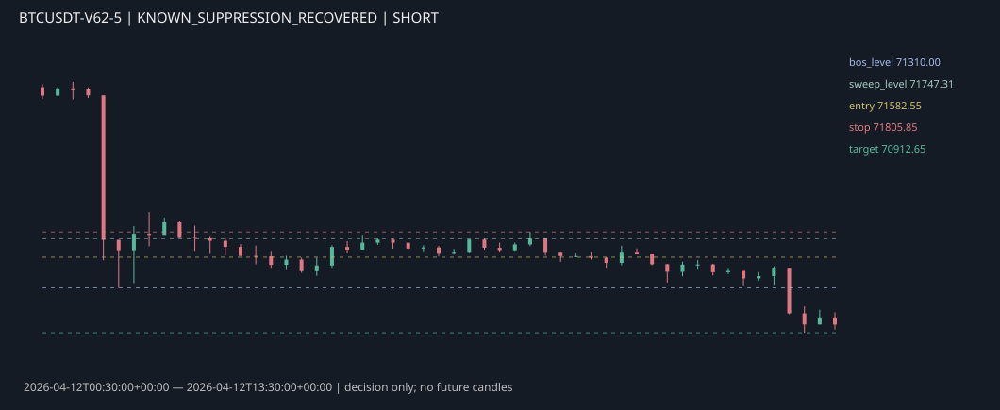

- Direction: SHORT; score: 75; missing: HTF.
- Candidate confirmed: 2026-04-12T13:45:00+00:00.
- Candidate setup ready: 2026-04-12T13:45:00+00:00; comparison terminal: see event ledger.
- Owner source/known: 2026-04-12T01:45:00+00:00 / None.
- Sweep/BOS: 2026-04-12T08:30:00+00:00 / 2026-04-12T12:45:00+00:00.
- Frozen range: 2026-04-12T08:30:00+00:00 → 2026-04-12T13:00:00+00:00.
- Checks: {"bos": true, "htf": false, "imbalance": true, "poc_pass": false, "sweep": true}.
- Expert verdict: PENDING. Explain the first incorrect or missing primitive, not whether the later trade wins.

## BTCUSDT-V62-6: KNOWN_SUPPRESSION_RECOVERED

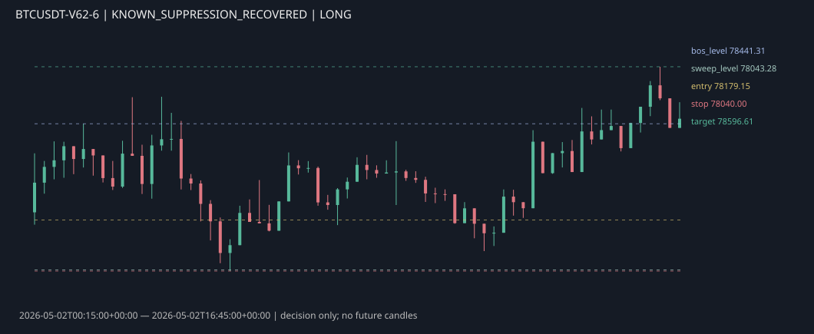

- Direction: LONG; score: 75; missing: HTF.
- Candidate confirmed: 2026-05-02T17:00:00+00:00.
- Candidate setup ready: 2026-05-02T17:00:00+00:00; comparison terminal: see event ledger.
- Owner source/known: 2026-05-02T01:30:00+00:00 / None.
- Sweep/BOS: 2026-05-02T05:15:00+00:00 / 2026-05-02T15:30:00+00:00.
- Frozen range: 2026-05-02T05:15:00+00:00 → 2026-05-02T16:15:00+00:00.
- Checks: {"bos": true, "htf": false, "imbalance": true, "poc_pass": false, "sweep": true}.
- Expert verdict: PENDING. Explain the first incorrect or missing primitive, not whether the later trade wins.

## BTCUSDT-V62-7: NO_LINKED_SWEEP_NEGATIVE

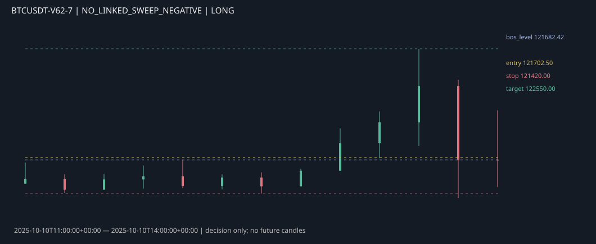

- Direction: LONG; score: 25; missing: HTF, LQ, FVG.
- Candidate confirmed: 2025-10-10T14:15:00+00:00.
- Candidate setup ready: NO ready setup asserted for this case; comparison terminal: see event ledger.
- Owner source/known: 2025-10-10T12:00:00+00:00 / None.
- Sweep/BOS: None / 2025-10-10T13:00:00+00:00.
- Frozen range: 2025-10-10T12:30:00+00:00 → 2025-10-10T13:30:00+00:00.
- Checks: {"bos": true, "htf": false, "imbalance": false, "poc_pass": false, "sweep": false}.
- Expert verdict: PENDING. Explain the first incorrect or missing primitive, not whether the later trade wins.

## XAUUSD-V62-1: SWEEP_CONTEXT_RECOVERED

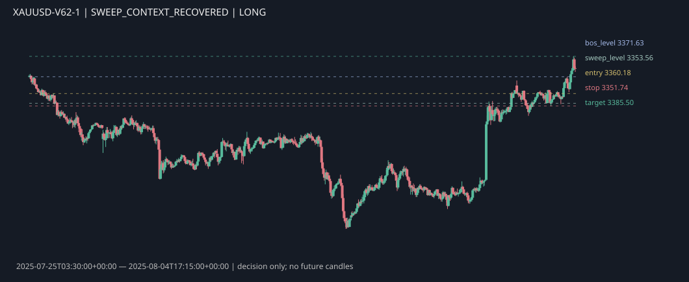

- Direction: LONG; score: 75; missing: HTF.
- Candidate confirmed: 2025-08-04T17:30:00+00:00.
- Candidate setup ready: 2025-08-04T17:30:00+00:00; comparison terminal: see event ledger.
- Owner source/known: 2025-07-25T04:45:00+00:00 / None.
- Sweep/BOS: 2025-08-04T13:15:00+00:00 / 2025-08-04T16:00:00+00:00.
- Frozen range: 2025-08-04T13:15:00+00:00 → 2025-08-04T16:45:00+00:00.
- Checks: {"bos": true, "htf": false, "imbalance": true, "poc_pass": false, "sweep": true}.
- Expert verdict: PENDING. Explain the first incorrect or missing primitive, not whether the later trade wins.

## XAUUSD-V62-2: V61_POSITIVE_PRESERVED

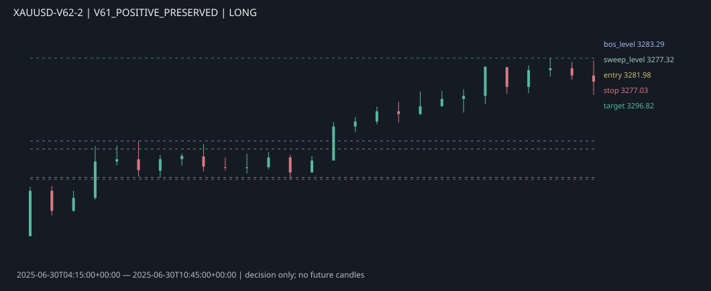

- Direction: LONG; score: 75; missing: HTF.
- Candidate confirmed: 2025-06-30T11:00:00+00:00.
- Candidate setup ready: 2025-06-30T11:00:00+00:00; comparison terminal: see event ledger.
- Owner source/known: 2025-06-30T05:30:00+00:00 / None.
- Sweep/BOS: 2025-06-30T07:15:00+00:00 / 2025-06-30T07:45:00+00:00.
- Frozen range: 2025-06-30T07:15:00+00:00 → 2025-06-30T10:15:00+00:00.
- Checks: {"bos": true, "htf": false, "imbalance": true, "poc_pass": false, "sweep": true}.
- Expert verdict: PENDING. Explain the first incorrect or missing primitive, not whether the later trade wins.

## XAUUSD-V62-3: SWEEP_CONTEXT_RECOVERED

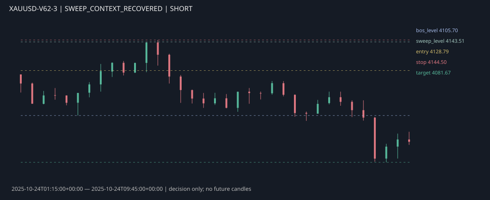

- Direction: SHORT; score: 100; missing: NONE.
- Candidate confirmed: 2025-10-24T10:00:00+00:00.
- Candidate setup ready: 2025-10-24T10:00:00+00:00; comparison terminal: see event ledger.
- Owner source/known: 2025-10-24T02:30:00+00:00 / None.
- Sweep/BOS: 2025-10-24T04:15:00+00:00 / 2025-10-24T08:45:00+00:00.
- Frozen range: 2025-10-24T04:15:00+00:00 → 2025-10-24T09:15:00+00:00.
- Checks: {"bos": true, "htf": true, "imbalance": true, "poc_pass": false, "sweep": true}.
- Expert verdict: PENDING. Explain the first incorrect or missing primitive, not whether the later trade wins.

## XAUUSD-V62-4: V61_POSITIVE_PRESERVED

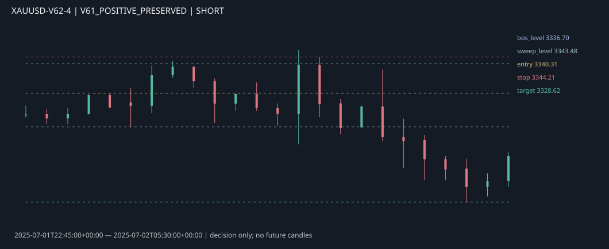

- Direction: SHORT; score: 75; missing: FVG.
- Candidate confirmed: 2025-07-02T05:45:00+00:00.
- Candidate setup ready: 2025-07-02T05:45:00+00:00; comparison terminal: see event ledger.
- Owner source/known: 2025-07-02T01:00:00+00:00 / None.
- Sweep/BOS: 2025-07-02T03:15:00+00:00 / 2025-07-02T03:30:00+00:00.
- Frozen range: 2025-07-02T03:15:00+00:00 → 2025-07-02T05:00:00+00:00.
- Checks: {"bos": true, "htf": true, "imbalance": false, "poc_pass": false, "sweep": true}.
- Expert verdict: PENDING. Explain the first incorrect or missing primitive, not whether the later trade wins.

## XAUUSD-V62-5: KNOWN_SUPPRESSION_RECOVERED

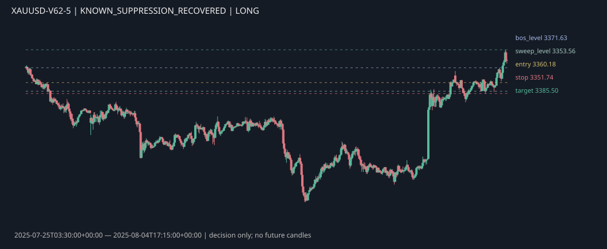

- Direction: LONG; score: 75; missing: HTF.
- Candidate confirmed: 2025-08-04T17:30:00+00:00.
- Candidate setup ready: 2025-08-04T17:30:00+00:00; comparison terminal: see event ledger.
- Owner source/known: 2025-07-25T04:45:00+00:00 / None.
- Sweep/BOS: 2025-08-04T13:15:00+00:00 / 2025-08-04T16:00:00+00:00.
- Frozen range: 2025-08-04T13:15:00+00:00 → 2025-08-04T16:45:00+00:00.
- Checks: {"bos": true, "htf": false, "imbalance": true, "poc_pass": false, "sweep": true}.
- Expert verdict: PENDING. Explain the first incorrect or missing primitive, not whether the later trade wins.

## XAUUSD-V62-6: KNOWN_SUPPRESSION_RECOVERED

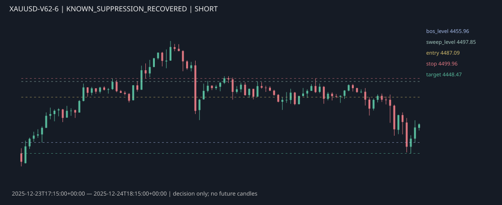

- Direction: SHORT; score: 75; missing: HTF.
- Candidate confirmed: 2025-12-24T18:30:00+00:00.
- Candidate setup ready: 2025-12-24T18:30:00+00:00; comparison terminal: see event ledger.
- Owner source/known: 2025-12-23T18:30:00+00:00 / None.
- Sweep/BOS: 2025-12-24T12:00:00+00:00 / 2025-12-24T17:30:00+00:00.
- Frozen range: 2025-12-24T12:00:00+00:00 → 2025-12-24T17:45:00+00:00.
- Checks: {"bos": true, "htf": false, "imbalance": true, "poc_pass": false, "sweep": true}.
- Expert verdict: PENDING. Explain the first incorrect or missing primitive, not whether the later trade wins.

## XAUUSD-V62-7: NO_LINKED_SWEEP_NEGATIVE

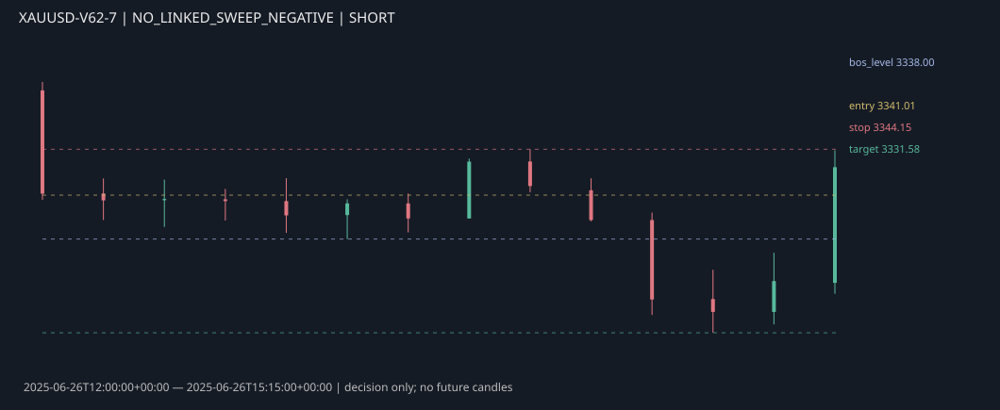

- Direction: SHORT; score: 25; missing: HTF, LQ, FVG.
- Candidate confirmed: 2025-06-26T15:30:00+00:00.
- Candidate setup ready: NO ready setup asserted for this case; comparison terminal: see event ledger.
- Owner source/known: 2025-06-26T13:15:00+00:00 / None.
- Sweep/BOS: None / 2025-06-26T14:30:00+00:00.
- Frozen range: 2025-06-26T14:00:00+00:00 → 2025-06-26T14:45:00+00:00.
- Checks: {"bos": true, "htf": false, "imbalance": false, "poc_pass": false, "sweep": false}.
- Expert verdict: PENDING. Explain the first incorrect or missing primitive, not whether the later trade wins.
